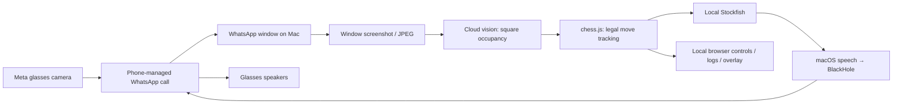

# Meta glasses chess practice

A working reconstruction of **chesshacker**, based on the source code and engineering notes in the supplied transcript. It watches a chessboard through a WhatsApp video call on a Mac, tracks legal moves, asks Stockfish for advice, and speaks the recommendation back through the call.

**The key trick:** the vision model recognizes **white / black / empty / unknown squares**, not piece identities. The tracker already knows the starting position and infers moves by comparing legal continuations. Stockfish chooses the recommendation. This project does **not** identify an arbitrary position from a photograph.



The reconstruction includes live Mac capture, recorded-video replay, OpenAI and Anthropic vision adapters, an optional Jev frame check, Stockfish, audio routing, browser controls, PGN/event logs, an OBS overlay, and video export. It also adds an offline demo, regression tests, reproducible dependencies and repairs to damaged pasted code. See [provenance and implementation details](docs/reconstruction.md).

## Try it without glasses or API keys

Node.js **22.12+** is required; Node **24** is recommended (`.nvmrc`). The lockfile is committed. Tested here on Linux x86-64 with Node 24; Mac hardware checks remain separate.

```sh
git clone --branch Frankstuff/meta-glasses-chess-reverse-engineering https://github.com/Frankstuff/glasses_stuff.git
cd glasses_stuff
npm ci
node dist/bin.js setup --engine-only
npm run demo
```

The demo prints its local browser URL. On a Mac it opens the page automatically; on Linux open that URL yourself. It uses **scripted occupancy observations and real Stockfish**. The JPEGs are rendered illustrations of those observations, so this demonstrates tracking, advice and the UI, **not visual recognition**. Audio is logged rather than played. The scripted game contains eight plies.

For a terminating smoke test:

```sh
npm run demo -- --no-browser --exit-at-end --every 0.01
npm run typecheck
npm test
npm run eval -- --simulate
```

The simulation follows the 33-ply Opera Game through synthetic observations, including occlusion. The final suite contains 95 tests; engine integration tests run when Stockfish is installed. No commands in this section call a paid model. CI executes these same checks.

`setup --engine-only` finds Stockfish on PATH or installs the official pinned Stockfish 19 build after SHA-256 verification. macOS, Linux x86-64 and Linux arm64 downloads are supported. You can also set `CHESSHACKER_STOCKFISH` to an existing executable.

## Run with glasses on an Apple Silicon Mac

1. Install Node 24, native WhatsApp for Mac and BlackHole 2ch. Install the repo as above.

   ```sh
   brew install node@24 blackhole-2ch
   export PATH="$(brew --prefix node@24)/bin:$PATH"
   npm ci
   node dist/bin.js setup
   ```

2. `setup` asks for a vision API key using hidden input, saves it in the macOS login Keychain, checks the configured model, installs Stockfish if needed, and opens Screen Recording settings. Grant permission to the actual terminal/app running the command and reopen it if macOS requests it. OpenAI is required for the default `gpt-6.1-sol`; Anthropic and Jev keys are optional. Model access is account dependent.

3. Pair the glasses with the phone and connect WhatsApp in Meta AI. Use the wearer’s WhatsApp account on the phone and a **separate recipient account linked to WhatsApp on the Mac** for the first test. Start and answer a video call. Enable **Glasses** view; the physical capture button is **double-pressed**, not the touchpad. Keep the call window open and the entire board visible.

4. In WhatsApp on the Mac, choose **BlackHole 2ch as the microphone** and unmute it. The app sends `say` output into BlackHole; WhatsApp carries that audio to the glasses. Keep WhatsApp’s speaker output on the normal Mac output.

5. Prove the transport before playing:

   ```sh
   node dist/bin.js windows
   node dist/bin.js test-call
   ```

   This saves and opens a captured frame, makes one paid vision request to check board visibility, and asks whether you heard a test phrase. Use `--window ID` if automatic window selection fails. It does not establish recognition accuracy or sustained latency.

6. Start a practice game from the standard position:

   ```sh
   node dist/bin.js run --color white --max-cost 1
   # or: --color black
   ```

   Sit on the side matching `--color`. If starting midway, supply a complete six-field `--fen` with the correct side to move, castling rights and en passant square. Those facts cannot be inferred from one image. Keep hands away between moves and allow two independent model readings before continuing.

The live setup requires macOS; running this inside a Linux cloud workspace cannot capture the Mac's call or play through its BlackHole device. The Mac can run a clone of this repository locally. [Hardware guide and official sources](docs/meta-glasses.md) cover model/platform support, troubleshooting, and the alternative Meta Device Access Toolkit path.

## Recordings, observations and controls

Record your own clip starting from a known position. Hold each completed move in view long enough for the selected model to read it twice. No real glasses recordings were supplied.

```sh
node dist/bin.js run --video my-game.mov --color white \
  --speak none --no-browser --no-gate --exit-at-end --max-cost 1

npm run eval -- my-game.mov --pgn my-game.pgn --color white --every 1 --max-cost 1
```

Live replay advances at wall-clock speed and keeps the latest frame; slow model reads can miss moves. The evaluator instead steps through sampled video frames, caches successful model answers, and compares detected moves to the supplied PGN without resynchronizing to the answer key. Use `[SetUp "1"]` and `[FEN "..."]` PGN headers for a nonstandard start. Evaluator output reports an exact match and correct prefix; PGN alone has no move timestamps, so it cannot measure actual move-to-speech latency.

The browser shows the latest frame, tracked board, recommendation, estimated spend and events. Its controls pause/resume, undo, enter a legal SAN/UCI move, repeat advice, or start from a corrected FEN. Changes are applied between frames. Recover a lost game manually; there is no automatic arbitrary-position recovery.

Open `/overlay` as an OBS Browser Source, or record it:

```sh
node dist/bin.js run --color white --overlay-out practice.mp4 --max-cost 1
```

Under sustained encoder backpressure, video output may drop frames and shorten the recording. The overlay locates board corners using **additional paid vision calls** while watched or recorded. Its graphics appear in the Mac browser/video, not in the glasses. Geometry is used for drawing only. The live call screenshot may include WhatsApp controls and borders.

## Configuration and costs

| Setting | Purpose |
| --- | --- |
| `OPENAI_API_KEY` | Overrides the OpenAI Keychain entry |
| `ANTHROPIC_API_KEY` | Overrides the Anthropic Keychain entry |
| `TYPESAFE_API_KEY` | Optional Jev frame check |
| `CHESSHACKER_MODEL` / `--model` | Vision model; default `gpt-6.1-sol` |
| `CHESSHACKER_STOCKFISH` | Stockfish executable override |
| `CHESSHACKER_DATA_DIR` | Private local data/log directory override |
| `--strategy occupancy\|changes\|pick` | Full squares, reference changes (default), or legal-move baseline |
| `--no-gate` | Disable Jev and its key check |
| `--every 1` | Sampling interval; your-turn pacing is at least three seconds |
| `--speak call\|speakers\|none` | BlackHole, Mac speakers, or logging only |
| `--max-advice-age 30` | Suppress advice from an older local capture; `0` disables |
| `--max-cost 1` | Pause after estimated spending exceeds $1 |

Use `node dist/bin.js run --help` for all flags. A `.env` file is **not loaded automatically**. If using the supplied `.env.example`, load your local copy with `node --env-file=.env dist/bin.js ...`.

The cap is an **estimate**, checked after returned usage. A running frame, optional gate and concurrent overlay request can overshoot it; retries with no returned usage and provider-specific billing may not be counted. Configure a provider-side budget too if a strict ceiling matters. Pausing at the cap cannot be bypassed with Resume; start another run with a different cap. [Dependency/model/pricing evidence](docs/dependencies.md) records the rates checked on 2026-10-28.

Default private data locations are `~/Library/Application Support/chesshacker` on macOS and `$XDG_DATA_HOME/chesshacker` (or `~/.local/share/chesshacker`) on Linux. A run writes `events.jsonl`, `game.pgn` after moves, and diagnostic frames. Captured images are sent to the configured vision provider (and Jev when enabled). Logs and keys are not committed. Recorded inputs and evaluator cache are gitignored.

## Verified scope and limitations

- Verified in this workspace: dependency installation, compilation, tests, official Stockfish download/startup and legal recommendations, synthetic full-game tracking, FFmpeg sampling, image/overlay rendering, local HTTP/SSE controls and the browser demo.
- Provider tests use mocked HTTP responses through the real SDKs. **No live vision call or recognition accuracy measurement was performed.** A successful mock or synthetic game does not validate physical-board perception.
- **No glasses, iPhone/Android phone, macOS screen permission, WhatsApp call, BlackHole routing or physical audio was tested here.** `test-call` is the next hardware experiment.
- Occupancy cannot distinguish underpromotions; automatic promotion inference uses a queen. Enter an underpromotion manually. Uncertain squares, ties and hands pause inference; substantial missed play can lose tracking.
- Periodic full-board reads reduce silent omissions in change detection. They do not provide automatic recovery. There is no phone app or Meta SDK integration in this implementation.
- Advice can still be outdated if the physical board changes after a capture. Local age checks do not include unknown call-transport delay, and already-playing speech cannot be recalled.
- No real-time latency or dollar-per-game claim has been measured. The transcript's reported timings are historical claims, not this reconstruction's benchmark.

Start reading with [`src/match.ts`](src/match.ts), [`src/vision.ts`](src/vision.ts), [`src/watch.ts`](src/watch.ts), and [`src/main.ts`](src/main.ts). The [engineering walkthrough](docs/reconstruction.md) traces a move and distinguishes recovered behavior from repairs. [Attribution](NOTICE.md) preserves the supplied author metadata.
